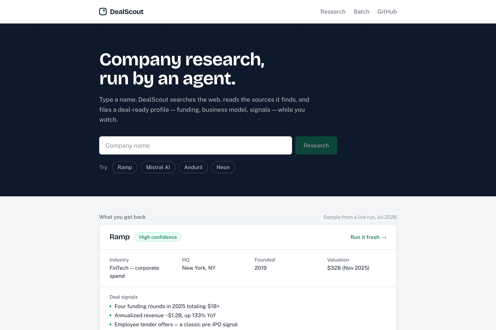
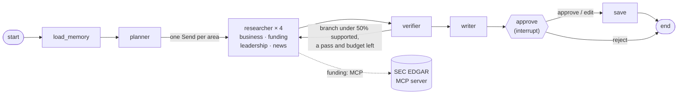

# DealScout — AI Company Research Agent

A research agent for deal sourcing. Type a company name and the agent searches
the web, reads sources, and returns a **structured company profile** (industry,
HQ, funding, leadership, news, deal signals) with a source for every field.

> Built to productionize a workflow I did manually as an AI Solutions Engineer
> intern at an M&A/investment firm: enriching company profiles for deal-sourcing
> pipelines.

There are two agents in this repo:

- **v1** (`/`, `lib/agent.ts`): one hand-rolled Claude tool loop that streams its
  steps to the browser. Kept as the baseline.
- **v2** (`/v2`, `agent/`): a stateful multi-agent workflow in LangGraph. A
  planner, parallel researchers, a verifier that checks every claim against its
  source, a writer that sees only verified claims, and a person who approves
  the draft before it's saved. It runs with Postgres checkpoints, memory across
  runs, resume after a crash, cost budgets, MCP both ways and tracing.

**Live demo:** https://dealscout-gamma.vercel.app (rate-limited to a few runs per visitor per day)



## v2: the research graph



1. **load_memory** reads the company's last saved profile, if any.
2. **planner** (structured output) picks the research areas and search ideas;
   with a saved profile it can skip areas that rarely change.
3. **researchers**, one per area and in parallel, use Anthropic's server-side
   `web_search` / `web_fetch` and report claims through a strict tool, each with
   a source URL and a verbatim quote. The funding researcher also reads SEC
   filings (a private company's Form D, a public one's S-1/10-K) through an
   external **MCP server**.
4. **verifier**: a claim passes only if its URL is one the run's tools actually
   returned (read from the API's result blocks, not from the model), and a model
   agrees its quote supports its value. A weak branch gets one more pass with
   the rejected claims and the reasons.
5. **writer** builds the profile from verified claims only; it never sees page
   text. Code attaches the sources per field and keeps saved values that weren't
   found again.
6. **approve** pauses the graph (`interrupt`) until a person approves, edits or
   rejects the draft in the UI (or over MCP). **save** writes a new version.

Every node boundary is a Postgres checkpoint, so a run cut off at any point
resumes from its last finished step, and the researchers that had finished
aren't run again.

**Deployment:** the Next.js app and the Python agent (FastAPI + LangGraph +
the Anthropic Python SDK) are two [Vercel Services](vercel.json) in one project.
The agent is private: only the app reaches it, through a service binding.
State is in Neon Postgres.

### Results

**Accuracy, cost and time** on 48 companies (144 graded fields: website domain,
founding year, HQ city), from `eval/RESULTS.md`:

| setup | fields correct | median cost | median time | runs over 300 s |
|---|---|---|---|---|
| v1, Sonnet 4.6 | 142/144 (98.6%) | $0.248 | 226 s | 11/48 |
| v1, Haiku 5.5 | 137/144 (95.1%) | $0.030 | 22 s | 0/48 |
| v2, Haiku 5.5 | 138/144 (95.8%) | $0.125 | 36 s | 0/48 |

- On the same model, **v2 costs about 4x v1 for the same accuracy** on these
  stable fields. What v2 buys isn't in them: every field backed by a claim that
  passed a source and quote check, memory, approval before save, resume after a
  crash, and a bounded run time.
- v1 on Sonnet is the most accurate, but a quarter of its runs exceed the
  deployed functions' 300 s limit, so they would fail on the live site. v2's
  parallel researchers keep every run under 3 minutes.
- About 70% of v2's claims pass the verifier; nearly all the rest fail the
  quote check, not the source check.
- Ground truth: the first 5 companies were checked by hand. The other 43 were
  checked by two independent automated lookups, not by hand
  ([review sheet](eval/ground-truth-review.md)).

**Prompt injection** (`eval/injection/`): six fictional company pages, each
carrying an injected instruction (fact override, fake operator message, canary
phrase, exfiltration fetch, suppression, smear). No v2 run let one reach the
draft (0 of 12, before and after the added defenses). v1, whose single agent
writes the profile from the page itself, put the canary phrase in its profile
in 1 of 15 runs. [Details](eval/injection/RESULTS.md).

**SEC EDGAR over MCP** (`eval/edgar.py`), on the funding researcher alone,
10 companies, run twice:

| setup | claims verified | citing sec.gov | cost |
|---|---|---|---|
| web only | 48/81, 54/83 | 4, 5 | $0.250, $0.251 |
| with EDGAR | 57/71, 60/80 | 11, 12 | $0.154, $0.168 |

### Design decisions

- **LangGraph for the workflow, the Anthropic SDK for the model calls** (not
  LangChain's wrappers): the graph gives checkpoints, `Send` fan-out and
  `interrupt`; the SDK keeps the server-side web tools, `pause_turn` and the
  exact usage numbers that cost tracking needs.
- **Verification is mechanical first.** A cited URL must be one the tools
  returned in this run, so a claim can't cite a page from memory; only then does
  a cheap model (Haiku 5.5, reason before verdict) check the quote. Fields no
  verified claim backs become "unknown".
- **Cost is part of the state.** Each node records its usage and cost
  (`agent/app/pricing.py`). A per-run budget is checked before the fan-out and
  before each retry; a daily cap over all runs answers 429. Prompt caching on
  the researchers is measured exactly (the same tokens priced uncached).
- **Haiku 5.5 for every node.** A sweep on Day 3 found Sonnet 5.5 researchers
  cost about 4x as much and got fewer fields right.
- **Strict tools everywhere**, the web tools included: Haiku sometimes sent
  malformed search input, and a pass whose searches all failed reported nothing.
- **Injection defenses at three layers:** page text is data, not instructions,
  for the researcher; `web_fetch` opens only URLs from the prompt or from search
  results, never a URL a page names; and the verifier treats a quote addressed
  to AI agents as supporting nothing.
- **MCP both ways.** `/api/mcp` serves v1's `research_company` and v2's
  `start_profile_run`, `get_profile_run` and `decide_profile_run`. It's a
  hand-rolled, stateless Streamable-HTTP JSON-RPC handler, and the official MCP
  Python client works against it. The funding researcher is an MCP *client* of
  [cyanheads/secedgar-mcp-server](https://github.com/cyanheads/secedgar-mcp-server):
  it lists the server's tools at runtime, offers three to the model, runs the
  calls in its own loop (capped in number and size), and only sec.gov URLs the
  results name may be cited. If the server is down, the pass carries on with
  web tools.
- **Tracing with Langfuse** (`agent/app/tracing.py`), on when its keys are set.
  There's one trace per run, so a resume or the approval step joins the run's
  trace. It has a span per graph node, a generation per model request with
  usage and this app's own cost, and a tool span per EDGAR call. The Anthropic
  SDK's own spans are left out: Langfuse priced them at a sixth of the real
  cost. The trace id is a hash of the run id, because the MCP client sends
  the trace context to the EDGAR server and a run id would let anyone read
  the run.
- **Approvals are gated on public deployments.** An approval writes the profile
  every later run starts from, so with `V2_ADMIN_TOKEN` set, deciding a run
  needs that token (the run page asks for it; MCP clients send it as a bearer
  token).

### Scheduled eval

`.github/workflows/eval.yml` runs the v2 eval on real models in CI: the 5
original companies weekly (about $0.65), or all 48 by hand. A hard spend cap
is enforced three ways (the eval script, the agent's daily cap and each run's
budget). The job fails when fewer than 85% of fields are correct. It needs an
`ANTHROPIC_API_KEY` repository secret and does nothing without one.

## v1: the single-agent loop

```
Browser ──POST /api/research──▶ Next.js Route Handler (streams NDJSON events)
                                       │
                                       ▼
                              Agent loop (lib/agent.ts)
                                       │  Claude API
                                       ▼
              ┌─────────────────── tools ────────────────────┐
              │ web_search / web_fetch (server-side,         │
              │ run on Anthropic's infra — no scraper here)  │
              │ save_profile (custom, strict JSON schema)    │
              └──────────────────────────────────────────────┘
```

- **Hand-rolled agent loop, no framework.** The loop is ~100 lines and handles
  the three stop reasons that matter: `pause_turn` (the server-side tool loop
  needs resuming: re-send as is), `tool_use` (the custom tool fired: capture its
  input and return a `tool_result`), and `refusal`/`end_turn` (stop).
- **Structured output via a strict tool instead of prose JSON:** `strict: true`
  makes the API validate the arguments, so `block.input` is a typed profile.
- **Streaming end to end:** the SDK stream becomes app-level events (`status` /
  `thinking` / `text` / `profile`) piped to the browser as NDJSON.
- **Demo-mode cost guardrails:** a per-IP daily cap (in memory, so on
  serverless each warm instance has its own counter) and `max_uses` on the web
  tools. v1 and v2 share the cap.
- **Model and effort are configurable** (`DEALSCOUT_MODEL`, `DEALSCOUT_EFFORT`):
  a model swap silently changes latency, and Sonnet at default effort researched
  past Vercel's 300 s function limit.
- **Batch mode** (`/batch`): up to 10 companies in sequence, with CSV export.

## Run locally

v1 only needs the Next.js app:

```bash
npm install
cp .env.example .env.local   # add your ANTHROPIC_API_KEY
npm run dev
```

v2 also needs Postgres and the agent (Python 3.13, [uv](https://docs.astral.sh/uv/)):

```bash
cd agent
uv sync --extra dev
DATABASE_URL=postgresql://localhost/dealscout uv run python -m app.migrate
AGENT_MODELS=anthropic DATABASE_URL=postgresql://localhost/dealscout \
  uv run --env-file ../.env.local uvicorn app.main:app --port 8001
# in the repo root:
AGENT_URL=http://127.0.0.1:8001 npm run dev
```

With `AGENT_MODELS` unset, the agent runs fake models: the whole graph, with no
API calls or cost.

| variable | where | what it does |
|---|---|---|
| `ANTHROPIC_API_KEY` | app, agent | the API key |
| `DATABASE_URL` | agent | Postgres (`DATABASE_URL_UNPOOLED` for migrations, if set) |
| `AGENT_URL` | app | where the agent is (set by the service binding on Vercel) |
| `AGENT_MODELS` | agent | `anthropic` for real models; `fake` (default) for none |
| `AGENT_DAILY_USD` | agent | daily spend cap over all runs (default $5 with real models) |
| `AGENT_RUN_BUDGET_USD` | agent | per-run budget (default $1.50) |
| `AGENT_PLANNER_MODEL`, `AGENT_RESEARCHER_MODEL`, `AGENT_VERIFIER_MODEL`, `AGENT_WRITER_MODEL` | agent | models (default `claude-haiku-5-5`) |
| `AGENT_EFFORT`, `AGENT_SEARCHES` | agent | researcher and writer effort (default `medium`); web searches per researcher request (default 3) |
| `EDGAR_MCP_URL` | agent | the EDGAR MCP server (default: the public instance); empty turns EDGAR off |
| `LANGFUSE_PUBLIC_KEY`, `LANGFUSE_SECRET_KEY`, `LANGFUSE_BASE_URL` | agent | tracing; off unless both keys are set |
| `V2_ADMIN_TOKEN` | app | if set, deciding a run needs this token |
| `DEMO_DAILY_LIMIT` | app | runs per IP per day, v1 and v2 together (default 10) |
| `DEALSCOUT_MODEL`, `DEALSCOUT_EFFORT` | app | v1's model and effort |

Tests: `npm test` (Vitest; the SDK and `fetch` are mocked) and, in `agent/`,
`uv run pytest` (against a real Postgres named by `TEST_DATABASE_URL`, whose
database name must contain "test"; the database tests skip without it).

## Evaluation

`eval/run-eval.mjs <base-url> --api v1|v2 --label <label> --max-usd <cap>`
grades the agent on `eval/ground-truth.json` and records each run's time, cost,
model requests, searches and claims; `eval/report.mjs` renders every result
into [eval/RESULTS.md](eval/RESULTS.md). `--max-usd` is a hard spend cap for
the whole eval. Also: `eval/replay.py` (re-run the verifier and writer on a
saved run's findings), `eval/injection/` (the injection pages and runner) and
`eval/edgar.py` (the EDGAR comparison). `NOTES.md` has the day-by-day log,
including what didn't work.

## Tech

Next.js 16 (App Router) · TypeScript · Tailwind CSS · Anthropic SDKs
(TypeScript and Python) · LangGraph · FastAPI · Postgres (Neon) · MCP (official
Python SDK) · Langfuse · Vercel Services
